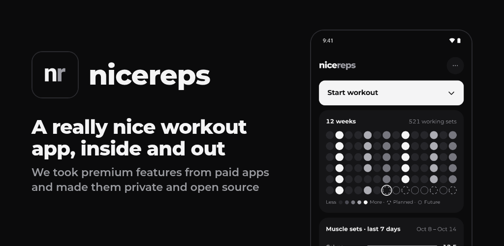
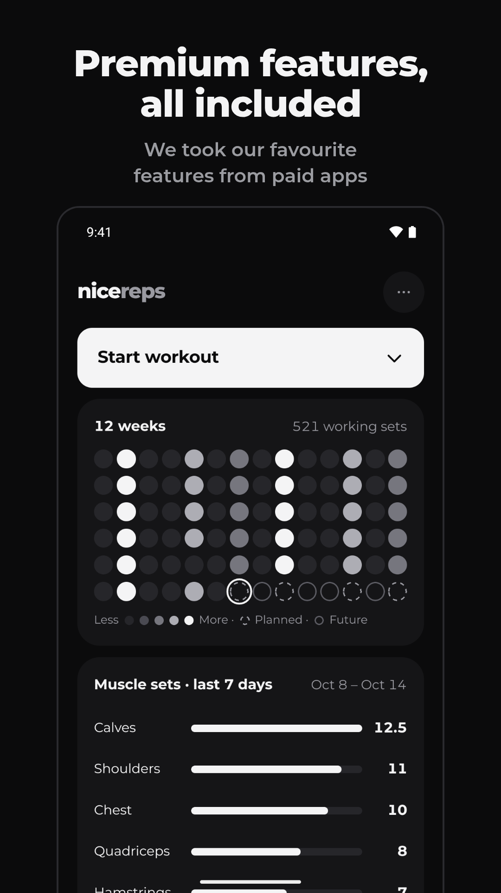
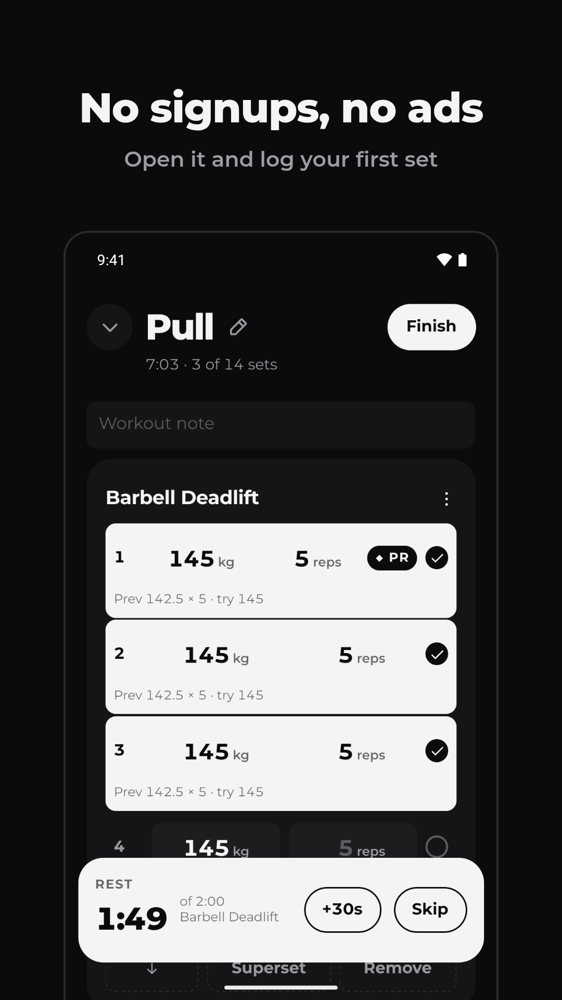
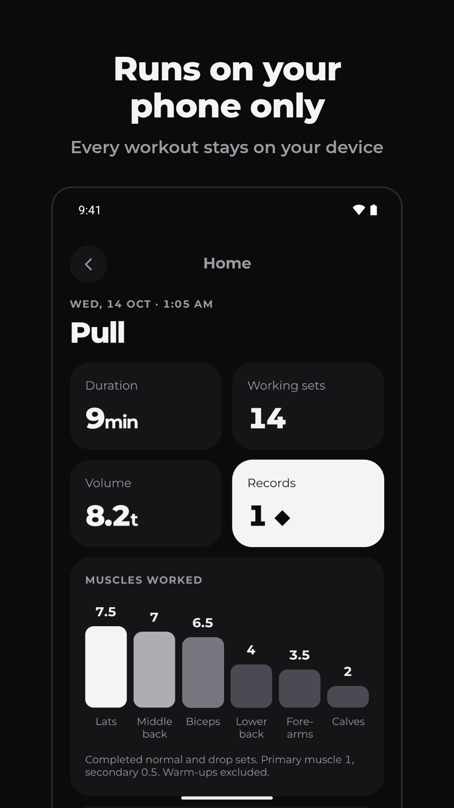
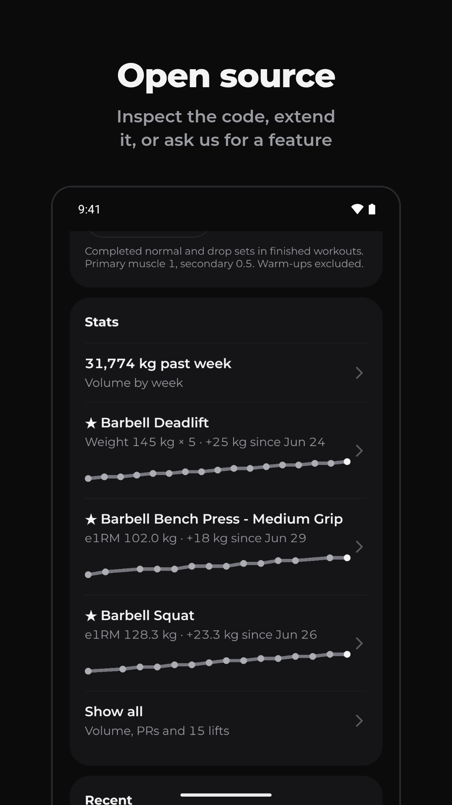

# nicereps

A fast, offline workout log for Android and iOS. Everything stays on your phone: no account, no ads, no analytics and no subscription. Free and open source under the GPL.

[buildnice.app/nicereps](https://buildnice.app/nicereps)

<p>
  
  
  
  
</p>

## Join the beta

Google Play needs 12 testers using nicereps for 14 days before it can be published. To help, [join the tester group](https://groups.google.com/g/buildnice-closed-testers), then [opt in and install](https://play.google.com/apps/testing/com.buildnice.nicereps). Please stay opted in for the 14 days.

On iPhone? [Join the TestFlight beta](https://testflight.apple.com/join/SYHhANWd).

## Features

- **Log fast.** Sets and reps, timed holds, distance, intervals and check-off exercises. Warm-ups, drop sets, supersets, RPE, notes and last session's numbers beside each set.
- **Rest timer** with sound and vibration, even when the phone is locked.
- **Plates per side** for barbell work, with your own bar and plates.
- **PR badges** the moment you beat your best weight, estimated 1RM or hold.
- **Plan and track.** A 12-week heatmap, weekly templates with local reminders, muscle sets, and stats for volume and every lift.
- **Measurements and progress photos** that stay on your phone.
- **Your data.** Export everything to one ZIP, back up to a folder you choose, and import from Strong, Hevy, FitNotes, StrengthLog or a spreadsheet.
- **Works with every radio off.** Android release builds have no internet permission.

## Build it

The app runs in a development client, not Expo Go. With [mise](https://mise.jdx.dev) and the Android SDK in `~/Android/Sdk`, run `mise install` once (it provides JDK 17 and sets `ANDROID_HOME`), start an emulator or connect a phone, then:

```sh
npm install
npm run android
```

After the first build, `npm start` is enough until native code or app config changes. `npm run typecheck`, `npm run lint` and `npm test` are the checks CI runs; `npm run e2e` runs the [Maestro](https://maestro.dev) flows against an installed build.

A standalone build bundles the JS and needs no Metro server: `npx expo run:android --variant release`. There are no over-the-air updates; every change ships in a new build.

## CLI

The CLI runs the app's domain operations against a local SQLite file. It needs Node 22.18 or later.

```sh
npm run cli -- /tmp/nicereps.sqlite seed
npm run cli -- /tmp/nicereps.sqlite totals 2026-09-30
npm run cli
```

The last command lists every command.

## Docs

- [Product](docs/PRODUCT.md): features and data rules.
- [Design](docs/DESIGN.md): screens, interactions and visual system.
- [Architecture](docs/ARCHITECTURE.md): app, storage, CLI, imports and device previews.
- [Contributing](AGENTS.md): working rules and proof for each change.

## License

App code and documentation: [GPL-3.0](LICENSE). Exercise data and images: [Free Exercise DB](assets/catalog/NOTICE.md), public domain. Montserrat: [SIL OFL](assets/fonts/OFL.txt). Vendored agent skills keep their upstream MIT licenses; see [skill sources](.agents/skills/SOURCES.md).
